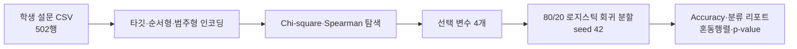
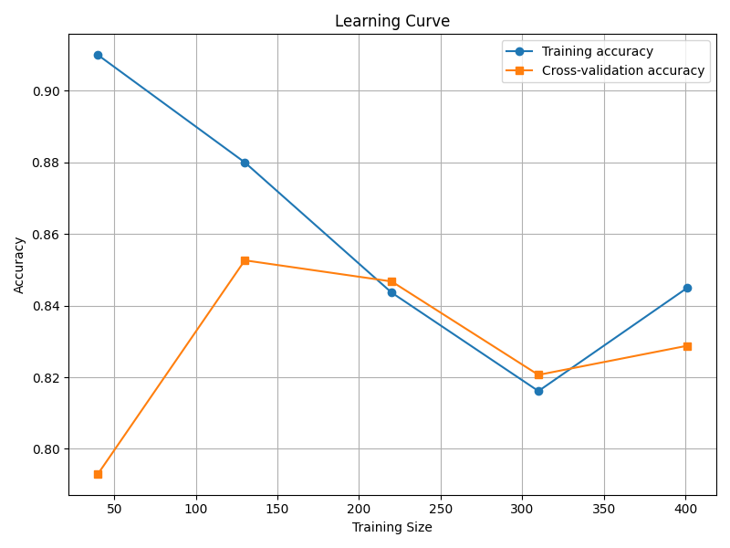

# 학생 설문 기반 우울 라벨 분류

[English](README.md) · [사례 연구](PORTFOLIO.ko.md)

502명이 응답한 학생 설문에서 어떤 생활·스트레스 응답이 우울 라벨(Yes/No)과 함께 나타나는지 로지스틱 회귀로 탐색합니다. 인천대학교 프로그래밍언어 과목 기말 프로젝트(2024년 11~12월)입니다. 탐색용 분석이며 진단 도구가 아닙니다.

**왜 중요한가:** 정신건강 설문 데이터는 작고 민감하므로, 불투명한 모델로 점수를 높이기보다 신호를 담은 소수의 응답을 찾고 그 계수를 누구나 확인할 수 있게 하는 것이 목표입니다.

**결과:** 설문 변수 4개를 쓴 로지스틱 회귀가 101건 holdout(seed 고정 80/20 분할)에서 **accuracy 0.9010**, **weighted F1 0.90**을 기록했습니다. 항상 다수 라벨을 예측하면 **0.5248**입니다.

## 데이터

- `data/Depression Student Dataset.csv`: 502행, 11개 컬럼, 결측 없음. 라벨은 균형에 가깝습니다(Yes 252, No 250). 출처: [Kaggle Depression Student Dataset](https://www.kaggle.com/datasets/ikynahidwin/depression-student-dataset/data).
- 변수: 성별, 나이, 학업 압박, 학업 만족도, 수면 시간, 식습관, 자살사고 이력, 공부 시간, 재정 스트레스, 정신질환 가족력, 우울 라벨.

## 접근 방법



- `src/preprocessing.py`는 `Depression` 타깃, 순서형 3개, 범주형 5개를 인코딩합니다.
- `src/train.py`는 식습관, 자살사고 이력, 학업 압박, 재정 스트레스를 사용해 지표용 scikit-learn 로지스틱 회귀와 계수·p-value용 statsmodels Logit을 함께 실행합니다.
- `src/generate_plots.py`는 Spearman, countplot, learning curve 그림을 만듭니다.

로지스틱 회귀는 모든 예측을 계수 4개로 추적할 수 있게 합니다. 변수 선택은 라벨과의 chi-square 검정에서 p<0.05인 범주형 변수(식습관, 자살사고 이력)와 Spearman |ρ|가 0.3 이상인 순서형 변수(학업 압박 0.48, 재정 스트레스 0.30)를 남깁니다.

## 결과

| 모델 | 변수 | Accuracy | Weighted F1 | 평가 조건 |
|---|---|---:|---:|---|
| 다수 라벨("Yes") | 없음 | 0.5248 | - | 같은 101건 holdout(양성 53건) |
| 로지스틱 회귀 | 선택 변수 4개 | 0.9010 | 0.90 | seed 고정 80/20 분할, 비층화 |

혼동행렬 `[[42, 6], [4, 49]]`: 양성 53건 중 49건, 음성 48건 중 42건을 맞혔습니다. Logit 계수 4개는 학습 요약에서 모두 p<0.001입니다. 전체 출력(포함된 데이터로 2026-08-20에 스크립트 실행): [`results/model_summary.txt`](results/model_summary.txt). 기준선 행은 이 파일의 클래스별 support에서 계산했습니다.


*그림 1. 포함된 설문 데이터의 탐색적 상관이며, 피처 검토에 사용했습니다.*


*그림 2. 한 설문 응답에 따른 라벨 분포(서술적).*



*그림 3. 학습 데이터 크기별 학습 정확도와 5-fold 교차 검증 정확도입니다. 101건 holdout과는 별개인 안정성 확인입니다.*

## 실행

Python 3.13.2에서 스크립트 컴파일을 확인했습니다.

```powershell
pip install -r requirements.txt
python src\preprocessing.py
python src\train.py
python src\generate_plots.py
```

`src/train.py`는 지표를 출력하고 `results/model_summary.txt`를 쓰며, `src/generate_plots.py`는 그림 5개를 `results/figures/`에 저장합니다. `src/config.py`가 데이터 경로, 출력 디렉터리, 분할 비율, seed, 선택 변수를 관리합니다.

## 한계

- 임상 판단이나 자동화된 고위험 의사결정에 쓰면 안 됩니다. 한 설문 표본 안의 연관성이며 원인이나 임상적 위험이 아닙니다.
- 무작위 분할 한 번이며 반복·외부 검증, 신뢰구간, 보정, 하위집단 분석이 없습니다.
- 노트북의 학습 정확도(0.8354)가 holdout 0.9010보다 낮아 분할이 유리하게 나왔을 가능성이 있습니다.
- 변수는 분할 전 502행 전체로 골랐으므로 holdout 정확도가 낙관적일 수 있습니다.
- 자살사고 이력은 라벨이 측정하려는 개념과 겹치며 계수가 가장 큽니다. 정확도 중 이 변수의 몫은 확인하지 않았습니다.
- 다른 모델과는 비교하지 않았습니다.

## 저장소 구조

```text
src/                  전처리, 학습, 시각화, 공통 설정
data/                 설문 CSV
results/              유지 중인 스크립트의 모델 요약과 그림
notebooks/            출력이 저장된 원본 탐색 노트북
doc/                  프로젝트 보고서(한국어 PDF)
images/               results/figures/와 같은 그림 사본
```

## 문서

- [포트폴리오 사례 연구](PORTFOLIO.ko.md)
- [프로젝트 리뷰](docs/PROJECT_REVIEW.md)
- [아키텍처](docs/ARCHITECTURE.md)
