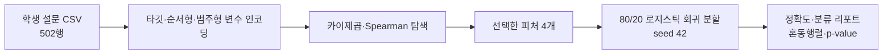

# 학생 우울 설문 분석: 해석 가능한 로지스틱 회귀

학생 502명의 설문에서 어떤 생활·스트레스 응답이 우울 여부(Yes/No) 라벨과 함께 움직이는지 보여 주는 4변수 로지스틱 회귀 모델입니다. 인천대학교 프로그래밍언어 수업의 기말 프로젝트(2024년 11~12월)입니다. 탐색적 분석이며 진단 도구가 아닙니다.

**문제.** 정신 건강 설문 데이터는 작고 민감합니다. 그래서 불투명한 모델로 점수를 끌어올리기보다, 신호를 담은 소수의 응답을 찾고 계수를 직접 들여다볼 수 있게 하는 것을 목표로 했습니다.

**결과.** 101건 holdout(seed 고정 80/20 분할)에서 정확도 0.9010, weighted F1 0.9009를 기록했습니다. 항상 다수 라벨로 예측하면 정확도 0.5248입니다.

**범위.** 무작위 분할 한 번이고 변수를 분할 전 502건 전체에서 골랐으므로 holdout 성능이 낙관적일 수 있으며, 계수는 연관성일 뿐 임상적 위험이 아닙니다. 데이터는 포함되어 있으며, `python src\train.py`로 지표를 다시 출력하고 `results/model_summary.txt`를 생성할 수 있습니다.

[English](README.md) · [사례 연구](PORTFOLIO.ko.md) · [모델 요약](results/model_summary.txt)

## 데이터

- `data/Depression Student Dataset.csv`: 502행, 11열, 결측 없음. 라벨은 균형에 가깝습니다(Yes 252, No 250). 출처: [Kaggle Depression Student Dataset](https://www.kaggle.com/datasets/ikynahidwin/depression-student-dataset/data).
- 변수: 성별, 나이, 학업 압박, 학업 만족도, 수면 시간, 식습관, 자살 생각 경험, 공부 시간, 재정 스트레스, 정신 질환 가족력, 우울 라벨.

## 접근 방식



- `src/preprocessing.py`는 `Depression` 타깃, 순서형 변수 3개, 범주형 변수 5개를 인코딩합니다.
- `src/train.py`는 식습관, 자살 생각 경험, 학업 압박, 재정 스트레스를 씁니다. 지표는 scikit-learn 로지스틱 회귀로, 계수와 p-value는 statsmodels Logit으로 구합니다.
- `src/generate_plots.py`는 Spearman 상관, countplot, 학습 곡선 그림을 만듭니다.

로지스틱 회귀를 쓰면 모든 예측을 계수 4개로 따라갈 수 있습니다. 피처는 라벨과의 카이제곱 검정에서 p < 0.05인 범주형 변수(식습관, 자살 생각 경험)와, 소수 둘째 자리로 반올림한 Spearman |ρ|가 0.3 이상인 순서형 변수(학업 압박 0.48, 재정 스트레스 0.30)로 골랐습니다.

## 결과

| 모델 | 피처 | 정확도 | weighted F1 | 조건 |
|---|---|---:|---:|---|
| 다수 라벨("Yes") | 없음 | 0.5248 | – | 같은 101건 holdout(101건 중 양성 53건) |
| 로지스틱 회귀 | 선택한 4개 | 0.9010 | 0.9009 | seed 고정 80/20 분할, 층화 없음 |

혼동행렬 `[[42, 6], [4, 49]]`: 양성 53건 중 49건, 음성 48건 중 42건을 맞혔습니다. 학습 요약에서 Logit 계수 4개는 모두 p < 0.001입니다. 전체 출력: [`results/model_summary.txt`](results/model_summary.txt).


*그림 1. 설문 데이터의 탐색적 상관. 피처 검토에 썼습니다.*


*그림 2. 설문 응답 하나에 따른 라벨 분포(기술 통계).*


*그림 3. 학습 데이터 크기별 학습 정확도와 5-fold 교차검증 정확도. 101건 holdout과는 별개인 안정성 점검입니다.*

## 실행

```powershell
pip install -r requirements.txt
python src\preprocessing.py
python src\train.py
python src\generate_plots.py
```

`src/train.py`는 지표를 출력하고 `results/model_summary.txt`를 씁니다. `src/generate_plots.py`는 `results/figures/`에 그림 5개를 저장합니다. 데이터 경로, 출력 폴더, 분할 비율, seed, 선택 피처는 `src/config.py`에 모여 있습니다.

## 한계

- 임상 판단이나 자동화된 고위험 결정에 쓰면 안 됩니다. 계수는 설문 표본 하나 안의 연관성이며 원인이나 임상적 위험이 아닙니다.
- 무작위 분할 한 번뿐이고 반복 검증이나 신뢰구간이 없습니다. 노트북의 학습 정확도(0.8354)가 holdout 0.9010보다 낮아, 유리한 분할이었을 가능성이 있습니다.
- 분할 전에 502행 전체로 피처를 골랐으므로 holdout 정확도가 낙관적일 수 있습니다.
- 자살 생각 경험은 라벨이 재는 개념과 겹치고 계수도 가장 큽니다. 이 변수가 정확도에 얼마나 기여하는지는 확인하지 않았습니다.

## 저장소 구성

```text
src/                  전처리, 학습, 시각화, 공통 설정
data/                 설문 CSV
results/              모델 요약과 그림
notebooks/            출력이 저장된 원래 탐색 노트북
doc/                  프로젝트 보고서(한국어 PDF)
```

## 문서

- [포트폴리오 사례 연구](PORTFOLIO.ko.md)
- [아키텍처](docs/ARCHITECTURE.md)
