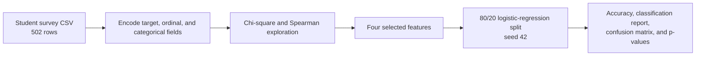

# Student Depression Survey: Interpretable Logistic Regression

Four-variable logistic regression that shows which lifestyle and stress
responses go with a Yes/No depression label in a 502-respondent student survey.
Final project for a Programming Languages course at Incheon National University
(November to December 2024). Exploratory analysis only; not a diagnostic tool.

**Problem.** Mental-health survey data is small and sensitive, so the aim is to
find the few responses that carry the signal, with coefficients a reader can
inspect, rather than to maximize a score with an opaque model.

**Result.** On a 101-record holdout (seeded 80/20 split), the model reaches
0.9010 accuracy and 0.9009 weighted F1, against 0.5248 accuracy for always
predicting the majority label.

[한국어](README.ko.md) · [Case study](PORTFOLIO.md) · [Model summary](results/model_summary.txt)

## Data

- `data/Depression Student Dataset.csv`: 502 rows, 11 columns, no missing
  cells; labels are balanced (252 Yes, 250 No). Source: the
  [Kaggle Depression Student Dataset](https://www.kaggle.com/datasets/ikynahidwin/depression-student-dataset/data).
- Fields: gender, age, academic pressure, study satisfaction, sleep duration,
  dietary habits, suicidal-thought history, study hours, financial stress,
  family history of mental illness, and the depression label.

## Approach



- `src/preprocessing.py` encodes the `Depression` target, three ordinal fields,
  and five categorical fields.
- `src/train.py` uses dietary habits, suicidal-thought history, academic
  pressure, and financial stress; it fits scikit-learn logistic regression for
  metrics and a statsmodels Logit model for coefficients and p-values.
- `src/generate_plots.py` produces Spearman, countplot, and learning-curve
  figures.

Logistic regression keeps every prediction traceable to four coefficients.
Feature selection keeps the categorical fields with chi-square p < 0.05 against
the label (dietary habits, suicidal-thought history) and the ordinal fields
with Spearman |ρ| of at least 0.3 after rounding to two decimals (academic
pressure 0.48, financial stress 0.30).

## Results

| Model | Features | Accuracy | Weighted F1 | Setting |
|---|---|---:|---:|---|
| Majority label ("Yes") | none | 0.5248 | – | Same 101-record holdout (53 of 101 positive) |
| Logistic regression | 4 selected | 0.9010 | 0.9009 | Seeded 80/20 split, not stratified |

Confusion matrix `[[42, 6], [4, 49]]`: 49 of 53 positive and 42 of 48 negative
labels correct. All four Logit coefficients have p < 0.001 in the training
summary. Full output: [`results/model_summary.txt`](results/model_summary.txt).


*Figure 1. Exploratory correlations from the survey data, used for feature
review.*


*Figure 2. Label distribution by one survey response (descriptive).*


*Figure 3. Training and 5-fold cross-validation accuracy across training-set
sizes; a stability check separate from the 101-record holdout.*

## How to run

```powershell
pip install -r requirements.txt
python src\preprocessing.py
python src\train.py
python src\generate_plots.py
```

`src/train.py` prints the metrics and writes `results/model_summary.txt`;
`src/generate_plots.py` writes five figures to `results/figures/`.
`src/config.py` centralizes the data path, output directory, split fraction,
seed, and selected features.

## Limitations

- Not for clinical or automated high-stakes decisions; the coefficients are associations in one survey sample, not causes or clinical risk.
- One random split with no repeated validation or confidence interval; the notebook's training accuracy (0.8354) is below the 0.9010 holdout figure, which suggests a favorable split.
- Features were selected on all 502 rows before the split, so holdout accuracy may be optimistic.
- Suicidal-thought history overlaps with the labeled construct and has the largest coefficient; its share of the accuracy was not tested.

## Repository layout

```text
src/                  preprocessing, training, plotting, shared config
data/                 survey CSV
results/              model summary and figures
notebooks/            original exploratory notebook with saved outputs
doc/                  project report (Korean PDF)
```

## Documentation

- [Portfolio case study](PORTFOLIO.md)
- [Architecture](docs/ARCHITECTURE.md)
