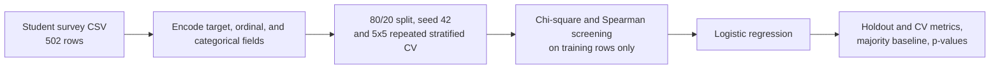
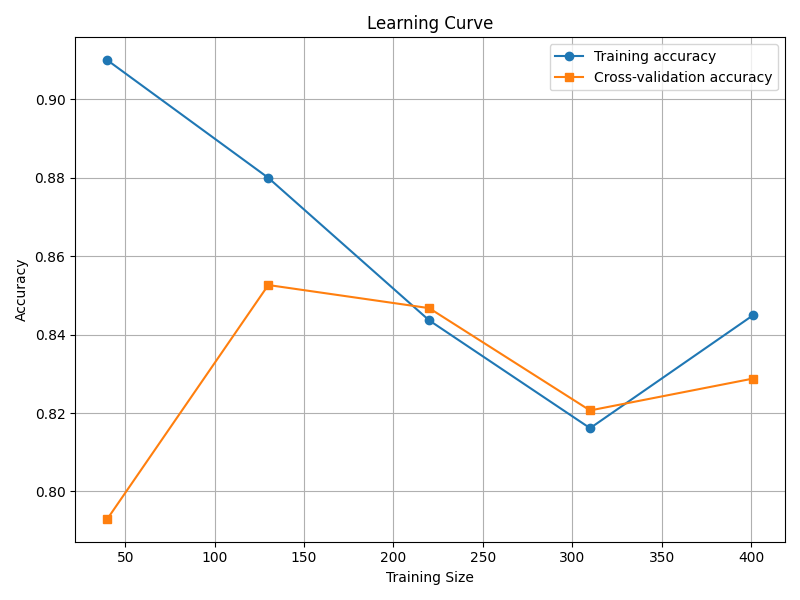

# Student Depression Survey: Interpretable Logistic Regression

Four-variable logistic regression that shows which lifestyle and stress
responses go with a Yes/No depression label in a 502-respondent student survey.
Final project for a Programming Languages course at Incheon National University
(November to December 2024). Exploratory analysis only; not a diagnostic tool.

**Problem.** Mental-health survey data is small and sensitive, so the aim is to
find the few responses that carry the signal, with coefficients a reader can
inspect, rather than to maximize a score with an opaque model.

**Result.** 5x5 repeated stratified cross-validation gives 0.8259 ± 0.0429
accuracy and 0.8255 ± 0.0431 weighted F1, against 0.5020 ± 0.0024 accuracy for
always predicting the majority label. On a 101-record holdout (seeded 80/20
split) the model reaches 0.8614 accuracy and 0.8609 weighted F1.

**Scope.** Features are screened on training rows only, inside every
cross-validation fold; coefficients are associations, not clinical risk. Data
is included; `python src\train.py` reprints the metrics and writes
`results/model_summary.txt`.

[한국어](README.ko.md) · [Case study](PORTFOLIO.md) · [Model summary](results/model_summary.txt)

## Data

- `data/Depression Student Dataset.csv`: 502 rows, 11 columns, no missing
  cells; labels are balanced (252 Yes, 250 No). Source: the
  [Kaggle Depression Student Dataset](https://www.kaggle.com/datasets/ikynahidwin/depression-student-dataset/data).
- Fields: gender, age, academic pressure, study satisfaction, sleep duration,
  dietary habits, suicidal-thought history, study hours, financial stress,
  family history of mental illness, and the depression label.

## Approach



- `src/preprocessing.py` encodes the `Depression` target, three ordinal fields,
  and five categorical fields.
- `src/train.py` screens the ten survey fields on training rows, fits
  scikit-learn logistic regression on the fields that pass, and runs 5x5
  repeated stratified cross-validation with screening refitted in every fold.
  A statsmodels Logit model on the training split gives coefficients and
  p-values.
- `src/generate_plots.py` produces Spearman, countplot, and learning-curve
  figures.

Logistic regression keeps every prediction traceable to a few coefficients.
Screening keeps categorical fields with chi-square p < 0.05 against the label
and numeric or ordinal fields with Spearman |ρ| of at least 0.3 after rounding
to two decimals (thresholds in `src/config.py`). On the 401 training rows it
keeps dietary habits, suicidal-thought history, academic pressure (ρ 0.470),
and study satisfaction (ρ −0.305); financial stress (ρ 0.291) falls just below
the cut-off. Across the 25 CV folds, the first three pass every time, financial
stress passes in 14 and study satisfaction in 9.

## Results

| Model | Features | Accuracy | Weighted F1 | Setting |
|---|---|---:|---:|---|
| Majority label | none | 0.5020 ± 0.0024 | 0.3355 ± 0.0027 | 5x5 repeated stratified CV, 502 rows |
| Logistic regression | screened per fold | 0.8259 ± 0.0429 | 0.8255 ± 0.0431 | 5x5 repeated stratified CV, 502 rows |
| Majority label (training majority "No") | none | 0.4752 | – | 101-record holdout (53 of 101 positive) |
| Logistic regression | 4 screened on training split | 0.8614 | 0.8609 | Seeded 80/20 split, not stratified |

Confusion matrix on the holdout `[[39, 9], [5, 48]]`: 48 of 53 positive and 39
of 48 negative labels correct. All four Logit coefficients have p < 0.001 in
the training summary; suicidal-thought history has the largest (3.5388). Full
output: [`results/model_summary.txt`](results/model_summary.txt).


*Figure 1. Exploratory correlations from the survey data, used for feature
review.*


*Figure 2. Label distribution by one survey response (descriptive).*



*Figure 3. Training and 5-fold cross-validation accuracy across training-set
sizes, with screening refitted on each training subset.*

## How to run

```powershell
pip install -r requirements.txt
python src\preprocessing.py
python src\train.py
python src\generate_plots.py
```

`src/train.py` prints the metrics and writes `results/model_summary.txt`;
`src/generate_plots.py` writes five figures to `results/figures/`.
`src/config.py` centralizes the data path, output directory, split fraction,
seed, and selected features.

## Limitations

- Not for clinical or automated high-stakes decisions; the coefficients are associations in one survey sample, not causes or clinical risk.
- The 101-record holdout (0.8614) sits above the cross-validation mean (0.8259 ± 0.0429); the CV figure is the steadier estimate.
- Financial stress and study satisfaction sit near the 0.3 Spearman cut-off, so which of them enters the model changes from fold to fold.
- Suicidal-thought history overlaps with the labeled construct and has the largest coefficient; its share of the accuracy was not tested.

**Lesson.** An earlier version screened features on all 502 rows before
splitting and reported 0.9010 holdout accuracy. Screening now runs on training
rows only; on the same split it swaps financial stress for study satisfaction,
and holdout accuracy is 0.8614.

## Repository layout

```text
src/                  preprocessing, training, plotting, shared config
data/                 survey CSV
results/              model summary and figures
notebooks/            original exploratory notebook with saved outputs
doc/                  project report (Korean PDF)
```

## Documentation

- [Portfolio case study](PORTFOLIO.md)
- [Architecture](docs/ARCHITECTURE.md)
